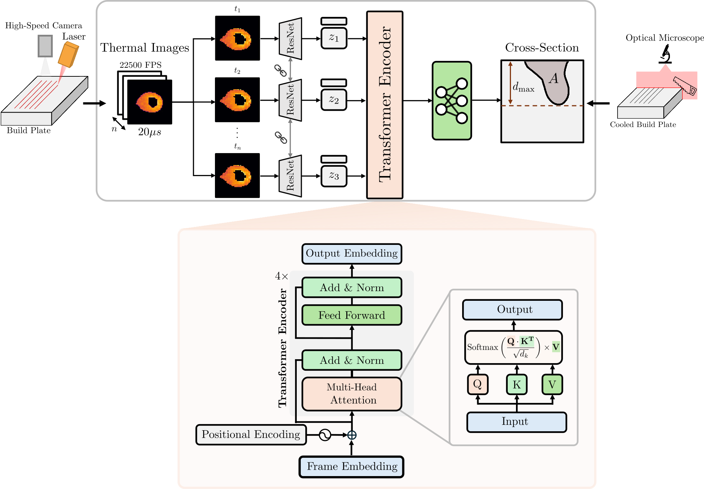
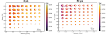
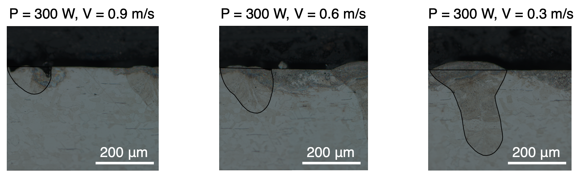

# MeltPoolContourPrediction

This repository contains the code corresponding to the paper [Deep learning for melt pool depth contour prediction from surface thermal images via vision transformers](https://www.sciencedirect.com/science/article/pii/S2772369024000513) published in Additive Manufacturing Letters. This work uses a hybrid CNN-Transformer architecture to predict the shape of a single bead melt pool cross-section based on the corresponding thermal images. 




## Abstract

Anomalous melt pools during metal additive manufacturing (AM) can lead to deteriorated mechanical and fatigue performance. In-situ monitoring of the melt pool subsurface morphology requires specialized equipment that may not be readily accessible or scalable. Therefore, we introduce a machine learning framework to correlate in-situ two-color thermal images observed via high-speed color imaging to the two-dimensional profile of the melt pool cross-section. We employ a hybrid CNN-Transformer architecture to establish a correlation between single bead off-axis thermal image sequences and melt pool cross-section contours measured via optical microscopy. Specifically, a ResNet model embeds the spatial information contained within the thermal images to a latent vector, while a Transformer model correlates the sequence of embedded vectors to extract temporal information. The performance of this model is evaluated through dimensional and geometric comparisons to the corresponding experimental no-powder melt pool observations. Our framework is able to model the curvature of the subsurface melt pool structure, with improved performance in high energy density regimes compared to analytical models. Additionally, the use of ratiometric temperature estimates improves the accuracy of the model predictions compared to monochromatic imaging. This work establishes a framework extensible towards powder-based AM builds.


## Dataset


### Image Sequences

The *in-situ* monitoring data collected for this work consists of high-speed two-color imaging of the melt pool, taken at 22500 FPS. More detail on this imaging method can be found in [Myers and Quirarte et al. (2023)](https://www.sciencedirect.com/science/article/pii/S2214860423002762). This data consists of experiments performed under 57 different combinations of laser power (*P*) and laser velocity (*V*), ranging from *P* = [50 W, 400 W] and *V* = [0.3 m/s, 2.4 m/s]. Each power-velocity combination is repeated at exposure times of 4 µs and 20 µs. Melt pool cross-sections were measured for 40 of these combinations, which are used for training (31) and testing (9). The remaining image sequences are included but have no label.

For analysis, two data formats are included:
* Monochromatic Image Intensity (`Mono`): Monochromatic images corresponding to the red channel of the raw data.

* Ratiometric Temperature Estimates (`Temp`): Thermal images computed from the relationship between the red and green channels. 




### Depth Contours

The *ex-situ* characterization data for this work consists of melt pool cross-sectional micrographs of single bead tracks. The contour lines outlining the shape of the melt pool cross-section have been manually extracted in ImageJ, and are stored as a set of $x$ and $y$ coordinates. During the training process, these contours are represented as a signed distance function (SDF) to enable the prediction of smooth contours with limited pixel resolution. This is set by `sdf: true` in the `yml` configuration file (or `--sdf` on the command line); with `sdf: false`, the contours are instead represented as binary masks.




## Getting Started 

### Installation Instructions


1. **Create a New Anaconda Environment**  
   To avoid conflicts with existing Python package installations, create a new Anaconda environment with Python 3.11 (`conda create -n experimental_depth_prediction python=3.11`).  
   Detailed instructions for creating and managing Anaconda environments can be found [here](https://conda.io/projects/conda/en/latest/user-guide/tasks/manage-environments.html).

2. **Install PyTorch**  
   After creating the environment, install PyTorch separately to ensure the version is compatible with your GPU drivers (if applicable).  
   Follow the official [PyTorch installation guide](https://pytorch.org) to select the appropriate version for your system. Training requires a CUDA GPU; the demo notebook also runs on CPU.

3. **Install Required Packages**  
   Once PyTorch is installed, use the following command from the repository root to install the remaining required packages listed in `requirements.txt`, along with this repository as a package:  
   ```pip install -r requirements.txt```  
   To reproduce the exact package versions used for the results in this work (PyTorch 2.10, CUDA 12.8), install from `requirements.lock.txt` instead.

4. **(Optional) Set up Weights and Biases (WandB) to track training progress**  
  The analysis scripts within this repository leverage the Weights and Biases platform to track experiment progress and store experiment results. This requires the creation of a Weights and Biases account ([wandb.ai](https://wandb.ai/home)) and logging in with `wandb login`. However, this is an optional step. WandB logging is off by default, and is turned on for a training run with `--wandb`. Without it, each run's settings, checkpoints and losses are still saved locally under `runs/`.


### Getting the data


Sample data and a trained model for the demo notebook are attached to the [latest release](https://github.com/BaratiLab/MeltPoolContourPrediction/releases/latest). To download both files and unzip it:

```
wget https://github.com/BaratiLab/MeltPoolContourPrediction/releases/latest/download/experimental_depth_prediction_sample_data.tar.gz
wget https://github.com/BaratiLab/MeltPoolContourPrediction/releases/latest/download/experimental_depth_prediction_sample_data.tar.gz.sha256
sha256sum -c experimental_depth_prediction_sample_data.tar.gz.sha256
tar xzf experimental_depth_prediction_sample_data.tar.gz

```

This creates:

* `data/sequence_exposure/sample`: thermal image sequences for five power-velocity combinations from the test set.
* `data/input_label_map`: the melt pool contour labels for these combinations.
* `checkpoints/sample_temporal_transformer.pth`: the sample trained model.

The sample data is sufficient to run the demo notebook. Training a new model requires the full training data, which is available on request.


### Exploring the implemented model

A sample notebook, `experimental_depth_prediction/demo.ipynb`, is provided to examine the dataset and inference process. A sample saved model is provided as `checkpoints/sample_temporal_transformer.pth`, and its yml configuration file is `experimental_depth_prediction/config/sample/sample_configuration_temporal_transformer.yml`. The notebook only needs the `data/sequence_exposure/sample` folder, the label files in `data/input_label_map`, and the sample model, so it can be run without the full training data.


### Training a new model

To train a new model, run the `main.py` script with a `yaml` file containing the intended values of your parameters. Specifically, the script can be run from the repository root as `python experimental_depth_prediction/main.py --yml finalized_temp_transformer`, where `finalized_temp_transformer` is the filename (without `.yml`) of a yml file within the `experimental_depth_prediction/config` directory. Files in subfolders are given with their folder, e.g. `--yml unet/finalized_mono_transformer_exp_20_temp_sdf`.

Any value in the yml file can be overridden from the command line, e.g. `--epochs 50`, `--sdf` to train on SDF labels, `--gpu 0`, or `--wandb` to log the run to Weights and Biases (off by default). Run `python experimental_depth_prediction/main.py --help` for the full list.

Each run saves its outputs to a new timestamped folder under `runs/` containing the settings it used (`config.yml`), the best checkpoints by loss, IoU and area R² (`ckpt_best_*.pth`), the loss per epoch (`train_loss.txt`, `test_loss.txt`), and example prediction plots.

### Configuration files

The `yml` files in `experimental_depth_prediction/config` correspond to the experiments in this work:

| File or folder | Model | Description |
|---|---|---|
| `finalized_temp_transformer.yml` | Temporal transformer | Main model: temperature images, 20 µs exposure, SDF labels. |
| `sample/` | Temporal transformer | Configuration of the provided sample model (same setup as above). |
| `unet/`, `ViT/` | UNet, Vision Transformer | Baseline models for each input combination. |
| `flow3d/`, `eagar_tsai/`, `finalized_temp_transformer_flow3d.yml` | All three | Training on FLOW-3D or Eagar-Tsai simulation data (not included in the data download). |
| `transfer/` | Temporal transformer | Fine-tuning a simulation-trained model on the experimental data. |

Within `unet/` and `ViT/`, the file names give the input combination: `exp_4` or `exp_20` is the exposure time in µs, `_temp` uses temperature images (monochrome otherwise), and `_sdf` uses SDF labels (binary masks otherwise).

The `transfer/` configurations start from a checkpoint trained with a `flow3d/` or `eagar_tsai/` configuration, so `model_artifact_path` in the `yml` file, or `--model_artifact_path` on the command line, must be set to that checkpoint.


### Analyzing model results with WandB

To analyze the performance of a model saved with WandB, run the script `experimental_depth_prediction/analysis/result_analysis/analyze_model_results.py` from the repository root with the appropriate arguments. For instance, `python experimental_depth_prediction/analysis/result_analysis/analyze_model_results.py -e run_id` will analyze the model saved in WandB under `run_id`.

This requires the model to have been trained with `--wandb`, since the script reads the run's configuration and loss history from WandB. Runs are looked up in your default WandB account and the `ExperimentalDepthPrediction-TempTransformer` project; use `--wandb_entity` and `--wandb_project` to point elsewhere. By default the model is downloaded from the run's WandB artifacts (`-v 0` is the best IoU checkpoint, `-v 1` the best loss, `-v 2` the best R²). To use a local checkpoint instead, pass its path with `-p`, e.g. `-p runs/.../ckpt_best_iou.pth`.

Add `-t` to compute train and test metrics, `-pv` to compute metrics for each process condition, and `-s sweep_id` to analyze every run in a WandB sweep. Results are written to `results/<run_id>/` in the repository root, or `results_<sweep_id>/` for a sweep.


## General Repository Structure
```
MeltPoolContourPrediction/
├── experimental_depth_prediction/   # Python package
│   ├── main.py                      # training entry point
│   ├── demo.ipynb                   # demo notebook
│   ├── analysis/                    # performance metrics for trained models, dataset properties
│   ├── config/                      # yml files specifying each training configuration
│   ├── datasets/                    # PyTorch dataset classes for pre-processing and training
│   ├── models/                      # PyTorch implementations of each model studied in this work
│   ├── runners/                     # training code
│   └── utils/                       # helper functions, from plotting to data pre-processing
├── data/                            # data (downloaded separately, see Getting the data)
│   ├── input_label_map/             # melt pool contour labels
│   └── sequence_exposure/           # thermal image sequences
│       └── sample/                  # subset used by the demo notebook
├── checkpoints/                     # sample trained model (downloaded with the data)
├── figures/                         # figures used in this README
├── requirements.txt
└── requirements.lock.txt

```
## Citation

If you use this code or data, please cite:

```bibtex
@article{ogoke2024deep,
  title     = {Deep learning for melt pool depth contour prediction from surface thermal images via vision transformers},
  author    = {Ogoke, Francis and Pak, Peter and Myers, Alexander and Quirarte, Guadalupe and Beuth, Jack and Malen, Jonathan and Barati Farimani, Amir},
  journal   = {Additive Manufacturing Letters},
  volume    = {11},
  pages     = {100243},
  year      = {2024},
  publisher = {Elsevier},
  doi       = {10.1016/j.addlet.2024.100243}
}
```